I like turning ideas into software that feels simple, fast and dependable. Always learning, always shipping.

 

### Tech I work with

<picture>
  <source media="(prefers-color-scheme: dark)" srcset="https://skillicons.dev/icons?i=cs,dotnet,rust,kotlin,androidstudio,py,js,git,vscode&theme=dark" />
  
</picture>

  

### Featured projects

<a href="https://github.com/unlimiteq/SideScreen">
  <picture>
    <source media="(prefers-color-scheme: dark)" srcset="https://raw.githubusercontent.com/unlimiteq/unlimiteq/output/project-sidescreen-dark.svg" />
    
  </picture>
</a>
<a href="https://github.com/unlimiteq/osutab">
  <picture>
    <source media="(prefers-color-scheme: dark)" srcset="https://raw.githubusercontent.com/unlimiteq/unlimiteq/output/project-osutab-dark.svg" />
    
  </picture>
</a>

  

### Stats

<picture>
  <source media="(prefers-color-scheme: dark)" srcset="https://raw.githubusercontent.com/unlimiteq/unlimiteq/output/stats-dark.svg" />
  
</picture>
<picture>
  <source media="(prefers-color-scheme: dark)" srcset="https://raw.githubusercontent.com/unlimiteq/unlimiteq/output/languages-dark.svg" />
  
</picture>

  

<picture>
  <source media="(prefers-color-scheme: dark)" srcset="https://raw.githubusercontent.com/unlimiteq/unlimiteq/output/snake-dark.svg" />
  
</picture>

<!-- Cards are regenerated daily by .github/workflows/profile.yml and published to the `output` branch. -->
